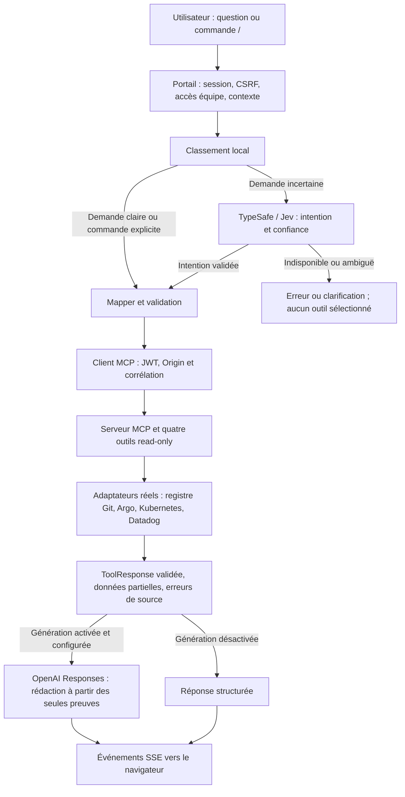

# Intégration MCP-CNP / cnp-portal

État vérifié le 7 octobre 2026. Branche portail : `feat/MCPapi`.

## Démarrage local avec les applications réelles

Depuis le dossier CNP, installer les dépendances et construire MCP une fois :

```bash
(cd MCP-CNP && npm ci && npm run build)
(cd cnp-portal && npm ci)
cd cnp-portal
npm run dev:integration
```

Arrêter les anciens processus sur 3000/3001 avant ce lancement. Le launcher démarre
MCP sur `127.0.0.1:3000` et le portail sur `http://localhost:3001`. Il vérifie le
catalogue avec un JWT valide et renouvelle les JWT locaux à chaque appel. Ctrl+C
arrête les deux services. L’application est à **http://localhost:3001/mcp-chat**.

**Ce lancement utilise désormais des sources réelles, sans fallback mock.** Il
réutilise les clients du portail et injecte les adaptateurs dans le serveur MCP
compilé de MCP-CNP. Il ne lance pas la Platform API Python de démonstration : le
catalogue provient du registre Git distant `apps/registry.yaml`. Une application
enregistrée n’est pas une preuve qu’elle tourne : son état observé vient d’Argo CD.

Pour lancer explicitement les données synthétiques :

```bash
npm run dev:integration:mock
```

## Fonctions du chat

- **Catalogue réel** : applications et environnements du registre Git. Les comptes
  manager voient le registre entier ; les autres comptes sont filtrés selon les
  permissions propriétaire/équipe déjà définies dans le portail, avant restitution
  des résultats et avant génération IA.
- **Routage hybride** : correspondance locale claire → outil ; demande ambiguë ou
  inconnue → TypeSafe/Jev. Si Jev ne répond pas, aucun outil sélectionné n’est
  exécuté. Les mutations sont rejetées localement et par la politique Jev.
- **Quatre outils MCP** : applications, état de déploiement, logs, FinOps. Ils
  utilisent les adaptateurs réels ; une source absente produit une erreur ou une
  réponse partielle, jamais une donnée inventée.
- **Génération OpenAI** : après le résultat validé, une API Responses transforme
  les données autorisées en réponse. Aucun outil d’écriture n’est fourni au modèle.
  La clé, l’identité et les cookies ne sont pas transmis dans les prompts. Les
  chaînes sensibles sont masquées. Sans génération disponible, le portail affiche
  une réponse structurée ; si une génération activée échoue, il signale ce repli.
- **Menu `/`** : taper `/` affiche les quatre commandes. ↑/↓ pour choisir,
  Entrée/Tab pour insérer, Échap pour fermer. Cliquer fonctionne aussi. Choisir
  l’application et l’environnement avant une commande ciblée. Les commandes
  explicites n’ont pas besoin de Jev.

| Commande | Requête |
| --- | --- |
| `/applications` | Lister les applications accessibles ; `en prod` peut filtrer le contexte |
| `/deploiement` | Version souhaitée, santé, synchronisation et drift de la cible |
| `/logs` | Logs de la dernière heure pour la cible |
| `/finops` | Recommandation de ressources ; les coûts réels ne sont pas configurés |
| `/aide` ou `/` envoyé directement | Afficher les commandes sans appel de source |

## Configuration des sources réelles

Conserver les valeurs secrètes uniquement dans `cnp-portal/.env`.

| Source | Configuration | Résultat de la vérification réelle |
| --- | --- | --- |
| Catalogue et configuration Git | `GITHUB_CONFIG_REPO_NAME`, `GITHUB_CONFIG_REPO_TOKEN` | Accès réussi ; neuf applications enregistrées |
| Argo CD | `ARGOCD_SERVER_URL`, `ARGOCD_TOKEN`, configuration TLS existante | Endpoint actuel `https://localhost:8080` indisponible |
| Kubernetes | `KUBE_API_URL`, `KUBE_TOKEN`, `KUBE_CA_CERT` | Lecture des Applications Argo refusée : HTTP 403 |
| Datadog logs | `DD_API_KEY`, `DD_APP_KEY`, `DD_SITE` | Clés absentes : erreur `OBSERVABILITY_NOT_CONFIGURED` |
| Datadog FinOps | Même accès + `MCP_CPU_PERCENT_METRIC`, `MCP_MEMORY_PERCENT_METRIC` | Métriques non configurées ; recommandation `INSUFFICIENT_DATA` |
| Jev | `TYPESAFE_ENABLED=true`, `TYPESAFE_API_KEY`, `TYPESAFE_BASE_URL`, `TYPESAFE_DEFAULT_MODEL`, `TYPESAFE_TIMEOUT_MS` | API réelle répond ; la requête testée demandait une clarification |
| OpenAI | `GENAI_ENABLED=true`, `GENAI_API_KEY`, `GENAI_MODEL` | Le modèle et la clé locale restent à fournir |

Le launcher reprend les variables `TYPESAFE_*` de `MCP-CNP/.env`, avec priorité
aux valeurs du portail. Les tokens Argo du portail ne sont pas remplacés par les
valeurs vides du MCP. Pour adapter le routage : `MCP_ROUTING_MODE=local|hybrid|jev`.
Le mode `jev` force la classification Jev pour les demandes libres ; les commandes
explicites restent déterministes.

Si vous utilisez Argo par tunnel local, démarrer avec votre contexte kubectl
habituel, dans un autre terminal :

```bash
kubectl -n argocd port-forward svc/argocd-server 8080:443
```

Un HTTP 403 Kubernetes nécessite des droits de lecture adaptés sur les ressources
concernées. Aucun droit cloud ou RBAC n’a été modifié par cette intégration.

Les logs Datadog sont filtrés sur `service:<applicationId> env:dev|prod` et la
fenêtre demandée. Les noms de service et tags doivent correspondre au déploiement.
Les métriques FinOps configurées doivent déjà être des **pourcentages de 0 à 100**,
avec ces mêmes tags. Le serveur utilise la couverture réellement observée, pas une
couverture artificielle égale à la fenêtre demandée.

Les états souhaités lisent les manifests du config-repo. Un claim Cloud Run
partagé `crossplane/cloudrun-claim.yaml` est traité comme la ressource dev ; il
n’est jamais présenté comme un déploiement prod indépendant. Les autres
ressources utilisent `overlays/dev|prod`. Adapter un nom Argo particulier avec
`MCP_ARGO_APPLICATIONS={"application/prod":"nom-argo"}`. Les images observées
proviennent du résumé Argo ; les digests Kubernetes viennent des pods réels.

Pour un workload GKE, le profil FinOps doit être explicitement décrit par les
annotations booléennes `cnp.io/stateless`, `cnp.io/workload-http` et
`cnp.io/requires-kubernetes`. En leur absence, le profil est inconnu ; aucun
profil fictif n’est produit. Les contraintes de Cloud Run sont lues dans le claim.

## Activer la génération OpenAI

Ajouter à `cnp-portal/.env`, puis redémarrer le launcher :

```dotenv
GENAI_ENABLED=true
GENAI_BASE_URL=https://api.openai.com/v1
GENAI_API_KEY=<votre clé locale>
GENAI_MODEL=<modèle choisi>
```

Ne collez jamais la clé dans un message de chat ou un fichier suivi par Git. La
requête utilise l’AI SDK avec le fournisseur OpenAI, l’API Responses et
`store=false`. Le test SDK utilise une réponse simulée ; il ne prouve pas l’accès
réel à votre compte/modèle. Références :
[OpenAI : génération de texte](https://developers.openai.com/api/docs/guides/text),
[AI SDK : generateText](https://ai-sdk.dev/docs/reference/ai-sdk-core/generate-text).

## Vérifications

```bash
npm run lint
npm test -- --runInBand
npm run test:integration
npm run test:generation
npm run test:live-sources
```

`test:integration` garde un environnement indépendant avec sources synthétiques,
JWT temporaires, MCP HTTP et Platform API Python HTTPS ; il vérifie le protocole
et les contrats. `test:generation` traverse réellement l’AI SDK/OpenAI avec une
réponse HTTP simulée ; aucune clé réelle n’est nécessaire. `test:live-sources`
effectue des lectures réelles et une classification Jev réelle avec les secrets
locaux, et indique les sources encore indisponibles. Il n’affiche aucun secret.

Le test navigateur vérifie la connexion locale, le catalogue réel, le menu `/`,
les commandes clavier et les quatre routes d’outils. Les erreurs Argo/Datadog sont
attendues tant que leurs accès n’ont pas été réparés.

## Interactions



[Visualisation](mcp-flow.html).

## Limites de déploiement

Le launcher natif et la signature locale sont réservés au développement loopback.
Pour un déploiement partagé, empaqueter/versionner le runtime MCP et Jev,
configurer HTTPS et une émission de tokens de service indépendante, et poursuivre
les validations d’accès de bout en bout. Aucun code du projet MCP-CNP n’a été
modifié pour ajouter du code portail : ses composants compilés sont réutilisés.
Les changements restent locaux, non commités et non poussés ; le stash de
sauvegarde initial est conservé.
