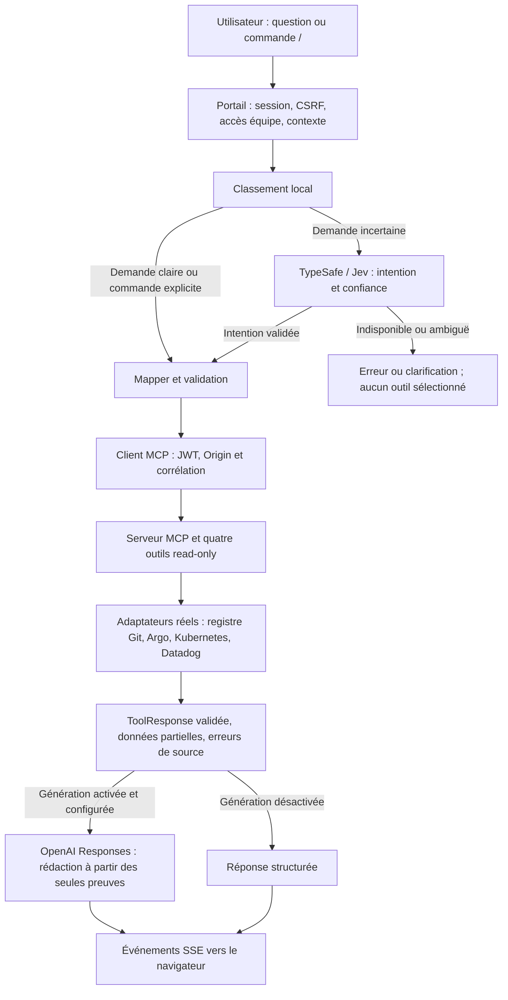

# Reprise du 26 octobre 2026

La branche isolée `feat/mcp-environment-integration` intègre main après les
changements dev/prod. Le checkout original et ses changements non commités
sont conservés. La suite combinée et les observations live sont détaillées à
la fin de ce document ; les notes du 19 octobre ci-dessous décrivent le point
de départ, pas un statut de livraison actuel.

Les spécifications de fonctionnement complet sont dans `MCP-CNP/specs/README.md`
(dossier du dépôt MCP voisin). Elles couvrent les droits serveur, la conversation,
les sources, le FinOps par équipe/coûts et la portabilité. FinOps V2 et
l’autorisation autonome multiutilisateur du serveur ne sont pas implémentés par
les correctifs de cette reprise.

# Intégration MCP-CNP / cnp-portal

État vérifié le 19 octobre 2026. Branche portail : `feat/MCPapi`.

Le périmètre FinOps futur (demandes par équipe/application, sources de coûts et
recommandations IA fondées sur les données) est décrit dans la
[spécification FinOps conversationnel](SPEC_FINOPS_CONVERSATIONNEL.md).
Cette spécification est à implémenter ; elle ne décrit pas des coûts déjà connectés.

## Démarrage local avec les applications réelles

Depuis le dossier CNP, installer les dépendances et construire MCP une fois :

```bash
(cd MCP-CNP && npm ci && npm run build)
(cd cnp-portal && npm ci)
cd cnp-portal
npm run dev:integration
```

Arrêter les anciens processus sur 3000/3001 avant ce lancement. Le launcher démarre
MCP sur `127.0.0.1:3000` et le portail sur `http://localhost:3001`. Il vérifie le
catalogue avec un JWT valide et renouvelle les JWT locaux à chaque appel. Ctrl+C
arrête les deux services. L’application est à **http://localhost:3001/mcp-chat**.

**Ce lancement utilise désormais des sources réelles, sans fallback mock.** Il
réutilise les clients du portail et injecte les adaptateurs dans le serveur MCP
compilé de MCP-CNP. Il ne lance pas la Platform API Python de démonstration : le
catalogue provient du registre Git distant `apps/registry.yaml`. Une application
enregistrée n’est pas une preuve qu’elle tourne : son état observé vient d’Argo CD.

Pour lancer explicitement les données synthétiques :

```bash
npm run dev:integration:mock
```

## Première implémentation utilisable

La fusion avec main est résolue dans le commit local `a1dfa96`. Les environnements
Python et caches ont été retirés de l’index Git, sans suppression sur disque.

Les commandes ci-dessous restituent désormais les données structurées dans le chat,
sans dépendre d’une génération IA :

- `/applications` : tableau des applications accessibles, équipes et environnements ;
- `/deploiement` : versions souhaitée/observée, digests disponibles, santé Argo CD,
  synchronisation et dérive (indéterminée si les preuves manquent) ;
- `/logs` : lignes datées, niveaux, messages et indication de résultats tronqués ;
- `/finops` : mesures disponibles, recommandation, prérequis et limites. Les coûts
  absents restent affichés comme indisponibles.

Les textes de source sont insérés via `textContent`, sans interprétation HTML.
Le nouvel événement SSE `tool_result` contient uniquement les données de l’outil
validées et filtrées par les permissions du portail ; il ne change pas les quatre
contrats du serveur MCP. Les réponses partielles sont identifiées et les résultats
restent visibles si la génération IA échoue. La lecture Argo CD utilise désormais
le client asynchrone et son authentification token ou login Terraform.

Depuis la liste des déploiements, « Analyser avec MCP » ouvre le chat avec
l’application présélectionnée. Choisir ensuite l’environnement et une commande.
Le filtrage des utilisateurs est actif pour les sources HTTP même sans
`MCP_DATA_MODE=real`. Le mode synthétique reste explicite avec le launcher `--mock`.

Validation : 79 tests et lint passent. Le test d’intégration vérifie le transport
MCP, les quatre outils, les refus d’accès, la réponse SSE et ses données structurées.
Ce test emploie une API locale et des données synthétiques ; le contrôle réel
séparé a confirmé neuf applications et un état Argo CD Healthy/Synced pour
`app-2-dancingduck`. La version observée manque dans ce résultat réel ; il est partiel.
Aucun déploiement, changement cloud ou appel IA payant n’a été effectué pour ce contrôle.

## Fonctions du chat

- **Catalogue réel** : applications et environnements du registre Git. Les comptes
  manager voient le registre entier ; les autres comptes sont filtrés selon les
  permissions propriétaire/équipe déjà définies dans le portail, avant restitution
  des résultats et avant génération IA.
- **Routage hybride** : correspondance locale claire → outil ; demande ambiguë ou
  inconnue → TypeSafe/Jev. Si Jev ne répond pas, aucun outil sélectionné n’est
  exécuté. Les mutations sont rejetées localement et par la politique Jev.
- **Quatre outils MCP** : applications, état de déploiement, logs, FinOps. Ils
  utilisent les adaptateurs réels ; une source absente produit une erreur ou une
  réponse partielle, jamais une donnée inventée.
- **Génération OpenAI** : après le résultat validé, une API Responses transforme
  les données autorisées en réponse. Aucun outil d’écriture n’est fourni au modèle.
  La clé, l’identité et les cookies ne sont pas transmis dans les prompts. Les
  chaînes sensibles sont masquées. Sans génération disponible, le portail affiche
  une réponse structurée ; si une génération activée échoue, il signale ce repli.
- **Menu `/`** : taper `/` affiche les quatre commandes. ↑/↓ pour choisir,
  Entrée/Tab pour insérer, Échap pour fermer. Cliquer fonctionne aussi. Choisir
  l’application et l’environnement avant une commande ciblée. Les commandes
  explicites n’ont pas besoin de Jev.

| Commande | Requête |
| --- | --- |
| `/applications` | Lister les applications accessibles ; `en prod` peut filtrer le contexte |
| `/deploiement` | Version souhaitée, santé, synchronisation et drift de la cible |
| `/logs` | Logs de la dernière heure pour la cible |
| `/finops` | Recommandation de ressources ; les coûts réels ne sont pas configurés |
| `/aide` ou `/` envoyé directement | Afficher les commandes sans appel de source |

## Clarifications et noms d’applications en langage naturel

Le dialogue conserve côté session l’outil demandé et les champs déjà fournis
pendant 15 minutes (20 demandes maximum). Il ne choisit pas un environnement
manquant à la place de l’utilisateur.

```text
Utilisateur : /deploiement
Portail     : Quelle application et quel environnement (dev ou prod) ?
Utilisateur : l’application sur le canard
Portail     : Quel environnement (dev ou prod) pour app-2-dancingduck ?
Utilisateur : en prod
Portail     : consultation du déploiement de cette application en prod
```

`/deploiment` et `/deployment` sont des alias acceptés. `/annuler` abandonne la
demande en attente ; une nouvelle commande `/` remplace l’intention précédente.
Le même dialogue fonctionne pour `/finops`. Un nom exact avec l’environnement
fonctionne sans IA, par exemple `app-2-dancingduck en dev`.

Les descriptions comme « le canard » utilisent la configuration `GENAI_*`.
Le modèle ne reçoit que la description nettoyée et les identifiants/noms des
applications autorisées. Il propose un identifiant existant avec une confiance
élevée ; le serveur revalide cet identifiant. Une ambiguïté, une proposition hors
catalogue ou une panne IA laisse la question ouverte. Le modèle ne choisit ni
outil d’écriture ni environnement. Le rapprochement sémantique est testé avec
une réponse simulée ; sa qualité réelle dépend du modèle configuré et doit être
vérifiée avec votre clé.

## Configuration des sources réelles

Conserver les valeurs secrètes uniquement dans `cnp-portal/.env`.

| Source | Configuration | Résultat de la vérification réelle |
| --- | --- | --- |
| Catalogue et configuration Git | `GITHUB_CONFIG_REPO_NAME`, `GITHUB_CONFIG_REPO_TOKEN` | Accès réussi ; neuf applications enregistrées |
| Argo CD | `ARGOCD_SERVER_URL`, token ou login Terraform, TLS existant | Connexion réussie via le tunnel ; état Healthy/Synced, version observée manquante pour l’app testée |
| Kubernetes | `KUBE_API_URL`, `KUBE_TOKEN`, `KUBE_CA_CERT` | Pour une app Cloud Run, le digest ne provient pas de pods GKE ; la preuve reste partielle |
| Datadog logs | `DD_API_KEY`, `DD_APP_KEY`, `DD_SITE` | Clés absentes : erreur `OBSERVABILITY_NOT_CONFIGURED` |
| Datadog FinOps | Même accès + `MCP_CPU_PERCENT_METRIC`, `MCP_MEMORY_PERCENT_METRIC` | Métriques non configurées ; recommandation `INSUFFICIENT_DATA` |
| Jev | `TYPESAFE_ENABLED=true`, `TYPESAFE_API_KEY`, `TYPESAFE_BASE_URL`, `TYPESAFE_DEFAULT_MODEL`, `TYPESAFE_TIMEOUT_MS` | API réelle répond ; la requête testée demandait une clarification |
| OpenAI | `GENAI_ENABLED=true`, `GENAI_API_KEY`, `GENAI_MODEL` | Le modèle et la clé locale restent à fournir |

Le launcher reprend les variables `TYPESAFE_*` de `MCP-CNP/.env`, avec priorité
aux valeurs du portail. Les tokens Argo du portail ne sont pas remplacés par les
valeurs vides du MCP. Pour adapter le routage : `MCP_ROUTING_MODE=local|hybrid|jev`.
Le mode `jev` force la classification Jev pour les demandes libres ; les commandes
explicites restent déterministes.

Si vous utilisez Argo par tunnel local, démarrer avec votre contexte kubectl
habituel, dans un autre terminal :

```bash
kubectl -n argocd port-forward svc/argocd-server 8080:443
```

Un HTTP 403 Kubernetes nécessite des droits de lecture adaptés sur les ressources
concernées. Aucun droit cloud ou RBAC supplémentaire n’a été modifié pendant cette itération MCP.

Les logs Datadog sont filtrés sur `service:<applicationId> env:dev|prod` et la
fenêtre demandée. Les noms de service et tags doivent correspondre au déploiement.
Les métriques FinOps configurées doivent déjà être des **pourcentages de 0 à 100**,
avec ces mêmes tags. Le serveur utilise la couverture réellement observée, pas une
couverture artificielle égale à la fenêtre demandée.

Les états souhaités lisent les manifests du config-repo. Un claim Cloud Run
partagé `crossplane/cloudrun-claim.yaml` est traité comme la ressource dev ; il
n’est jamais présenté comme un déploiement prod indépendant. Les autres
ressources utilisent `overlays/dev|prod`. Adapter un nom Argo particulier avec
`MCP_ARGO_APPLICATIONS={"application/prod":"nom-argo"}`. Les images observées
proviennent du résumé Argo ; les digests Kubernetes viennent des pods réels.

Pour un workload GKE, le profil FinOps doit être explicitement décrit par les
annotations booléennes `cnp.io/stateless`, `cnp.io/workload-http` et
`cnp.io/requires-kubernetes`. En leur absence, le profil est inconnu ; aucun
profil fictif n’est produit. Les contraintes de Cloud Run sont lues dans le claim.

## Activer la génération OpenAI

Ajouter à `cnp-portal/.env`, puis redémarrer le launcher :

```dotenv
GENAI_ENABLED=true
GENAI_BASE_URL=https://api.openai.com/v1
GENAI_API_KEY=<votre clé API OpenAI locale>
GENAI_MODEL=<identifiant du modèle accessible à votre clé>
```

Les quatre variables sont placées dans `cnp-portal/.env`, pas dans le navigateur
ni dans `.env.example`. La clé et le modèle sont tous deux obligatoires. Le modèle
doit supporter Responses et les sorties structurées. Redémarrer
`npm run dev:integration` après modification. La même configuration sert à la
résolution des descriptions d’applications et à la reformulation des résultats.

FinOps ne récupère pas ses mesures grâce à la clé IA. Pour une recommandation
basée sur l’utilisation, configurer aussi `DD_API_KEY`, `DD_APP_KEY`, `DD_SITE`,
`MCP_CPU_PERCENT_METRIC` et `MCP_MEMORY_PERCENT_METRIC`, avec une couverture
suffisante (14 jours demandés par le chat). Sans ces mesures, la réponse est
`INSUFFICIENT_DATA`. Aucun coût réel n’est connecté : les montants restent `null`.
Les logs sont laissés hors du jalon conversationnel actuel.

Ne collez jamais la clé dans un message de chat ou un fichier suivi par Git. La
requête utilise l’AI SDK avec le fournisseur OpenAI, l’API Responses et
`store=false`. Le test SDK utilise une réponse simulée ; il ne prouve pas l’accès
réel à votre compte/modèle. Références :
[OpenAI : sorties structurées](https://developers.openai.com/api/docs/guides/structured-outputs),
[AI SDK : generateText](https://ai-sdk.dev/docs/reference/ai-sdk-core/generate-text).

## Vérifications

```bash
npm run lint
npm test -- --runInBand
npm run test:integration
npm run test:generation
npm run test:context
npm run test:live-sources
```

`test:integration` garde un environnement indépendant avec sources synthétiques,
JWT temporaires, MCP HTTP et Platform API Python HTTPS ; il vérifie le protocole
et les contrats. `test:generation` traverse réellement l’AI SDK/OpenAI avec une
réponse HTTP simulée ; aucune clé réelle n’est nécessaire. `test:live-sources`
effectue des lectures réelles et une classification Jev réelle avec les secrets
locaux, et indique les sources encore indisponibles. Il n’affiche aucun secret.

Après configuration de votre clé, vérifier dans le navigateur le menu `/`, le
dialogue en plusieurs messages et la description « le canard ». Les tests
automatisés de ce jalon ne prouvent pas la qualité d’une réponse IA réelle.
`test:context` vérifie le format structuré Responses via le vrai SDK avec une
réponse simulée, sans clé réelle ni appel payant.

## Interactions



[Visualisation](mcp-flow.html).

## Limites de déploiement

Le launcher natif et la signature locale sont réservés au développement loopback.
Pour un déploiement partagé, empaqueter/versionner le runtime MCP et Jev,
configurer HTTPS et une émission de tokens de service indépendante, et poursuivre
les validations d’accès de bout en bout. Aucun code du projet MCP-CNP n’a été
modifié pour ajouter du code portail : ses composants compilés sont réutilisés.
Les changements restent locaux, non commités et non poussés ; le stash de
sauvegarde initial est conservé.


## Vérifier uniquement les sources, sans appel IA

```bash
npm run test:live-sources -- app-2-dancingduck --sources-only
```

Cette commande lit Git/Argo/Kubernetes/Datadog, sans Jev ni génération IA.
Un statut `partial` peut aussi correspondre à un champ manquant (digest, version,
coût), pas uniquement à une source totalement inaccessible. Les sources non
configurées sont signalées ; elles ne sont jamais remplacées par un mock.


## Compatibilité avec les déploiements dev/prod

Le filtre du portail vérifie désormais l’accès à l’environnement, avant de
consulter un outil ciblé ; les listes et propositions masquent les environnements
non accessibles. Les accès sont relus à chaque tour. Un enregistrement historique
conserve seulement sa compatibilité dev ; il ne donne pas prod.

Le lien « Analyser avec MCP » transmet l’application et l’environnement du
déploiement choisi. Le claim isolé d’environnement prime sur le claim historique.
Pour Cloud Run, la version observée vient du runtime effectivement prêt, jamais
du seul résumé d’images Argo. Une version ou un digest manquant reste inconnu.
La santé Argo peut être dégradée pour une route en échec alors que le runtime
sert correctement ; ces deux preuves ne doivent pas être confondues.

La recette suivante ouvre un serveur MCP loopback éphémère et une base SQLite
locale temporaire. Elle utilise la vraie connexion du portail, le contrôle CSRF,
le flux SSE et les adaptateurs natifs. Elle ne démarre aucun réconciliateur de
déploiement, n’écrit pas dans le cloud et n’appelle pas de service IA payant.

```bash
MCP_PROJECT_DIR=/chemin/MCP-CNP \
MCP_PORTAL_ENV_FILE=/chemin/cnp-portal/.env \
CLOUD_ENV_FILE=/chemin/cnp-portal/.env.cloud \
npm run test:live-environments -- app4-pixelcam
```

Les credentials sont chargés côté serveur et ne sont pas imprimés. La recette
exige des versions désirée/servie identiques et un runtime prêt pour dev/prod.
Un utilisateur dev seul est créé dans la base temporaire pour vérifier que prod
n’apparaît pas et qu’aucun outil de déploiement ne s’exécute pour cette cible.
Ce contrôle ne prouve pas l’autorisation autonome du serveur partagé : SPEC-02
reste nécessaire. Les sources Datadog/Billing et la qualité d’une réponse IA
réelle restent à vérifier séparément avant d’annoncer ces fonctionnalités.


### Résultats de recette du 26 octobre 2026

- Suite combinée portail/MCP/dev-prod : 20 suites, 151 tests réussis ; lint réussi.
- Dépôt MCP : typecheck et lint réussis, 58 tests réussis.
- Intégration croisée existante : transport HTTP MCP, quatre outils, contrats,
  Platform API HTTPS et refus de credentials réussis sur sources synthétiques.
- Génération et résolution de contexte : vrai SDK, réponses API simulées,
  vérifications de confidentialité réussies ; aucun appel IA payant.
- Recette live à 15:51 UTC : login, CSRF, SSE et MCP HTTP réels ; dev
  `566a33ac3d152eb07ab053df8bb1a179d8f4b33e` et prod
  `7050ee1f84fe69738011952ad0cfdbe263245026` correspondent aux images
  désirées et réellement prêtes. Le compte de recette dev seul ne voit pas prod
  et n’exécute pas d’outil de déploiement pour cette cible.
- Argo reste OutOfSync/Degraded pour les deux environnements ; les résultats
  sont partiels. Aucun changement cloud n’a été effectué pour ces tests.
